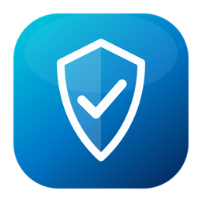

<br>
<p align="center">
  
</p>

<h1 align="center">DNS Leak Guard</h1>

<div align="center">

[](https://github.com/Tabstone/dns-leak-guard/releases)
[](https://github.com/Tabstone/dns-leak-guard/actions/workflows/build.yml)
[](#requirements)

</div>

🌍 **English** | [简体中文](./README.zh-CN.md)

DNS Leak Guard is a native SwiftUI app for finding and fixing DNS leaks caused
by Clash Verge and mihomo configurations. It also includes multi-site DNS leak
checks, a live connection view and a YAML rule workbench.

👉 [Download](https://github.com/Tabstone/dns-leak-guard/releases)

👉 [Deep links](#deep-links)

## Features

- Scan the active mihomo configuration for plaintext DNS, unbound DoH/DoT
  resolvers, misspelled DNS keys, `respect-rules` errors and rules that trigger
  unnecessary DNS resolution.
- Apply selected fixes with an on-disk backup and atomic write. A successful
  reload is performed through the local mihomo controller when available.
- Maintain Clash Verge's `dns_config.yaml` and profile DNS override state,
  including the profile confirmation value used by Clash Verge.
- Run DNS leak checks against BrowserLeaks, DNSLeakTest, IPLeak, BrowserScan,
  IP125, IPCheck.ing and Whoer. Results identify the actual resolver IP, ISP
  and location when the site exposes them.
- Inspect live mihomo connections, matched rules, proxy chains, processes and
  traffic totals.
- Create rules from live domains, reorder the complete rule set, validate it,
  export YAML, or apply it to the active configuration.
- Merge WhatsApp, Meta, local-network and Loyalsoldier rules into the Clash
  Verge profile merge file, with an optional "direct in China, proxy everything
  else" preset.
- Optionally watch Clash Verge files and restore selected DNS protections after
  changes.

## Requirements

- macOS 14 or later
- Clash Verge Rev with mihomo for live controller features
- No administrator privileges, network extension or Accessibility permission

Some features, including DNS override maintenance and rule merge, rely on the
Clash Verge directory layout. They are tested against Clash Verge Rev on macOS.

## Install

1. Open the [latest release](https://github.com/Tabstone/dns-leak-guard/releases).
2. Download the macOS ZIP and open it.
3. Move `DNSLeakGuard.app` to `Applications`.
4. On first launch, macOS may block the ad-hoc signed build. Use
   Control-click → Open.

The app runs as a menu bar utility. Open the dashboard from the menu bar icon.

## Deep links

The app registers the `dnsleakguard://` URL scheme.

```text
dnsleakguard://overview
dnsleakguard://findings
dnsleakguard://live-tests
dnsleakguard://traffic
dnsleakguard://repair
dnsleakguard://routing
dnsleakguard://protection
dnsleakguard://permissions
```

Read-only actions:

```text
dnsleakguard://scan
dnsleakguard://online-test
dnsleakguard://online-test?providers=browserleaks,ipleak
dnsleakguard://online-test?providers=all
```

Deep links never apply a repair, write a configuration, change a rule or reload
the core.

## Build

Install Xcode Command Line Tools or Xcode with Swift 6, then run:

```bash
./Tools/build-app.sh
```

The app is written to:

```text
dist/DNSLeakGuard.app
```

GitHub Actions builds a ZIP artifact for every tagged release.

## Privacy and safety

- No analytics, telemetry or account is required.
- Local configuration is read directly from the Clash Verge application support
  directory and is not uploaded.
- Online checks only send the DNS probe requests required by the selected leak
  test sites.
- Every write creates a backup in the same directory and uses an atomic replace.
- Subscription source files are not modified. Rule merge writes the current
  profile merge file and active generated configuration.
- The app does not request Full Disk Access, Accessibility, Screen Recording or
  root privileges.

## Known limitations

- DNS Leak Guard is an external companion. Clash Verge does not currently expose
  a general plugin API.
- Clash Verge subscription refresh can overwrite changes made only to the active
  generated configuration. Use the rule merge page for persistent rules.
- Whoer currently requires manual browser verification because its API is behind
  Cloudflare Managed Challenge.
- Online leak sites are a secondary signal. Packet capture or resolver-side logs
  remain the authoritative test.

## Acknowledgements

Clash Verge Rev, mihomo, Loyalsoldier/clash-rules and the DNS leak test sites
provide the services and formats this app works with. DNS Leak Guard is not
affiliated with those projects.
