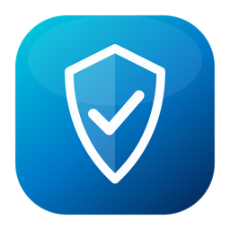

<br>
<p align="center">
  
</p>

<h1 align="center">DNS Leak Guard</h1>

<div align="center">

[](https://github.com/Tabstone/dns-leak-guard/releases)
[](https://github.com/Tabstone/dns-leak-guard/actions/workflows/build.yml)
[](#系统要求)

</div>

🌍 [English](./README.md) | **简体中文**

DNS Leak Guard 是一个原生 SwiftUI 工具，用于检查和修复 Clash Verge、mihomo
配置中的 DNS 泄露问题。它也提供多站点 DNS 测漏、实时连接查看和 YAML 规则
工作台。

👉 [下载](https://github.com/Tabstone/dns-leak-guard/releases)

👉 [深链](#深链)

## 功能

- 扫描当前 mihomo 配置中的明文 DNS、未绑定代理的 DoH/DoT、DNS 键名拼写、
  `respect-rules` 配置错误，以及会触发额外解析的规则。
- 按勾选项修复配置。写入前创建同目录备份，使用原子替换，并在可用时通过
  本地 mihomo 控制器重新加载。
- 维护 Clash Verge 的 `dns_config.yaml` 和订阅 DNS 覆写状态，包括 Clash
  Verge 使用的 confirmation 值。
- 通过 BrowserLeaks、DNSLeakTest、IPLeak、BrowserScan、IP125、IPCheck.ing
  和 Whoer 检测 DNS 泄露。站点返回解析器 IP、ISP 和地区时，工具会一并展示。
- 查看 mihomo 实时连接、命中规则、代理链、进程和流量。
- 从实时域名生成规则，调整完整规则顺序，校验、导出 YAML，或写入当前活动配置。
- 将 WhatsApp、Meta、局域网和 Loyalsoldier 规则合并到 Clash Verge Merge 文件，
  并提供“国内直连、其余全部代理”的可选预设。
- 可开启实时守护，在 Clash Verge 配置变化后恢复已勾选的 DNS 保护项。

## 系统要求

- macOS 14 或更高版本
- Clash Verge Rev 与 mihomo，用于实时控制器功能
- 不需要管理员权限、网络扩展或辅助功能权限

DNS 覆写和规则合并依赖 Clash Verge 的目录结构，目前以 macOS 上的 Clash
Verge Rev 为测试环境。

## 安装

1. 打开[最新 Release](https://github.com/Tabstone/dns-leak-guard/releases)。
2. 下载 macOS ZIP 并解压。
3. 将 `DNSLeakGuard.app` 移入 `Applications`。
4. 首次启动时，macOS 可能拦截 ad-hoc 签名版本。请按住 Control 点击应用，
   选择“打开”。

应用以菜单栏工具方式运行，可从菜单栏图标打开控制台。

## 深链

应用注册了 `dnsleakguard://` URL Scheme。

```text
dnsleakguard://overview
dnsleakguard://findings
dnsleakguard://live-tests
dnsleakguard://traffic
dnsleakguard://repair
dnsleakguard://routing
dnsleakguard://protection
dnsleakguard://permissions
```

只读检测动作：

```text
dnsleakguard://scan
dnsleakguard://online-test
dnsleakguard://online-test?providers=browserleaks,ipleak
dnsleakguard://online-test?providers=all
```

深链不会执行修复、写入配置、修改规则或重载内核。

## 构建

安装 Xcode Command Line Tools 或 Xcode，确保 Swift 6 可用，然后运行：

```bash
./Tools/build-app.sh
```

应用输出到：

```text
dist/DNSLeakGuard.app
```

推送版本标签后，GitHub Actions 会构建并上传 ZIP。

## 隐私与安全

- 不包含统计、遥测，也不需要登录账号。
- 本地配置直接从 Clash Verge 的应用支持目录读取，不会上传。
- 在线检测只会向所选测漏站点发送必要的 DNS 探测请求。
- 所有写入操作都会在同目录创建备份，并使用原子替换。
- 不修改订阅原文件。规则合并写入当前订阅的 Merge 文件和活动生成配置。
- 不申请全盘访问、辅助功能、屏幕录制或 root 权限。

## 已知限制

- DNS Leak Guard 是外部伴侣程序。Clash Verge 目前没有通用插件 API。
- 订阅刷新可能覆盖仅写入活动生成配置的修改。需要持久化的规则请使用规则
  合并页面。
- Whoer 的 API 受 Cloudflare Managed Challenge 保护，目前只提供网页复核。
- 在线测漏站点只能作为辅助判断。抓包或解析器侧日志仍然是更可靠的依据。

## 致谢

本项目使用或对接 Clash Verge Rev、mihomo、Loyalsoldier/clash-rules 及各 DNS
测漏站点。DNS Leak Guard 与这些项目没有隶属关系。
